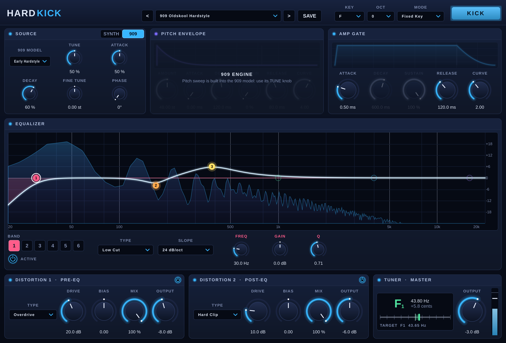

# HardKick

An oldskool hardstyle kick synthesizer (VST3 / AU / Standalone), built the way kicks were made
before sample packs: a swept oscillator, envelopes, and a **distort → EQ → distort** chain.
No samples anywhere.




Background research (909 circuit, oldskool method, other kick synths): [docs/RESEARCH.md](docs/RESEARCH.md)

## Signal flow

```
OSC + PITCH ENV + CLICK  →  CLIP 1 (pre-EQ)  →  6-band EQ  →  CLIP 2 (post-EQ)  →  OUTPUT
```

| Section | What it does |
|---|---|
| **Source: SYNTH** | Sine / Triangle / Warm Sine. Phase resets on every hit (identical punch every time), adjustable start phase. Noise **click** layer with decay and tone. |
| **Source: 909** | Synthesized 909-style bass drum (no samples) with 10 models (Classic, Long Tail, Punch, Deep, Hard Attack, Gabber, Early Hardstyle, Boom, Driven, Short Tok) and the original's **Tune / Attack / Decay** controls. In this mode the amp ADSR only gates the sound (attack and release). |
| **Key** | **F to E** (F1 43.65 Hz … E2 82.41 Hz), octave shift, and *Fixed Key* (any MIDI note plays the key) or *Follow MIDI*. |
| **Tuner** | Measures the actual root of the output (after distortion and EQ) and shows note, Hz and cents against the target key. |
| **Presets** | 17 factory presets (7 synth, 10 909) plus your own. Presets never change the key. |
| **Pitch envelope (ADSR)** | The classic pitch sweep. *Amount* (up to 96 semitones) above the played note, A/D/S/R and a *Curve* control (1 = linear, higher = snappier exponential drop). |
| **Amp envelope (ADSR)** | Volume shape with its own curve. Hold the MIDI note longer for a longer tail. |
| **Distortion 1 / 2** | 4× oversampled, 12 types: Hard Clip, Soft Clip, Tanh, Overdrive, Tube, Diode, Fuzz, Sine Fold, Tri Fold, Rectify, Bitcrush, Asym Clip. *Bias* adds asymmetry (even harmonics), plus Mix and Output. Each stage has a power button. |
| **EQ** | 6 bands: Low Cut, Low Shelf, Bell, Notch, High Shelf, High Cut (cuts at 12/24/48 dB/oct), with a live spectrum analyzer. |

The pitch comes from the *Key* setting, or from the MIDI note in *Follow MIDI* mode. *Fine Tune* shifts it in semitones.
The **KICK** button always plays the selected key.

User presets are saved as `.hkpreset` files in `Documents/HardKick/Presets`.

### EQ mouse controls
- **Drag a node**: frequency / gain (**Shift** for fine adjustments)
- **Mouse wheel** over a node: Q
- **Double-click a node**: band on/off
- **Double-click empty space**: adds a bell band there
- **Right-click a node**: filter type, slope, reset

## Building

Requires CMake ≥ 3.22 and a C++17 compiler (Visual Studio 2022 on Windows, Xcode on macOS).
JUCE 8 is downloaded automatically. You can point to your own copy with `-DJUCE_DIR=/path/to/JUCE`.

```bash
cmake -S . -B build -DCMAKE_BUILD_TYPE=Release
cmake --build build --config Release
```

Plugins end up in `build/HardKick_artefacts/Release/` (`VST3/HardKick.vst3`, `Standalone/`, and `AU/` on macOS).
Copy the `.vst3` to your plugin folder:
- Windows: `C:\Program Files\Common Files\VST3`
- macOS: `~/Library/Audio/Plug-Ins/VST3` (AU: `~/Library/Audio/Plug-Ins/Components`)

On Linux, install the JUCE dependencies first (e.g. `libasound2-dev libfreetype-dev libx11-dev libxext-dev libxinerama-dev libxrandr-dev libxcursor-dev libfontconfig1-dev libgl1-mesa-dev`).

### Offline test tool
`-DHK_BUILD_TOOLS=ON` builds `HardKickRender`. It renders every factory preset to WAV and measures each tail's pitch
with the tuner's detector. It also checks all 12 keys in both engines, tests state save/restore and saves GUI snapshots:
```bash
HardKickRender out/
```

## Source layout
```
Source/
  Parameters.*          all parameters (IDs, ranges, defaults)
  PluginProcessor.*     MIDI handling and the processing chain
  DSP/CurveEnvelope.h   ADSR with curve
  PresetManager.*       factory + user presets
  DSP/KickVoice.h       synth and 909 engines
  DSP/Kick909.h         909 model definitions
  DSP/PitchDetector.h   tuner pitch detection (McLeod / NSDF)
  DSP/ClipDistortion.h  oversampled clipper
  DSP/ParametricEQ.h    biquad EQ (shared by the DSP and the GUI curve)
  GUI/                  look and feel, widgets, EQ display, editor
```
