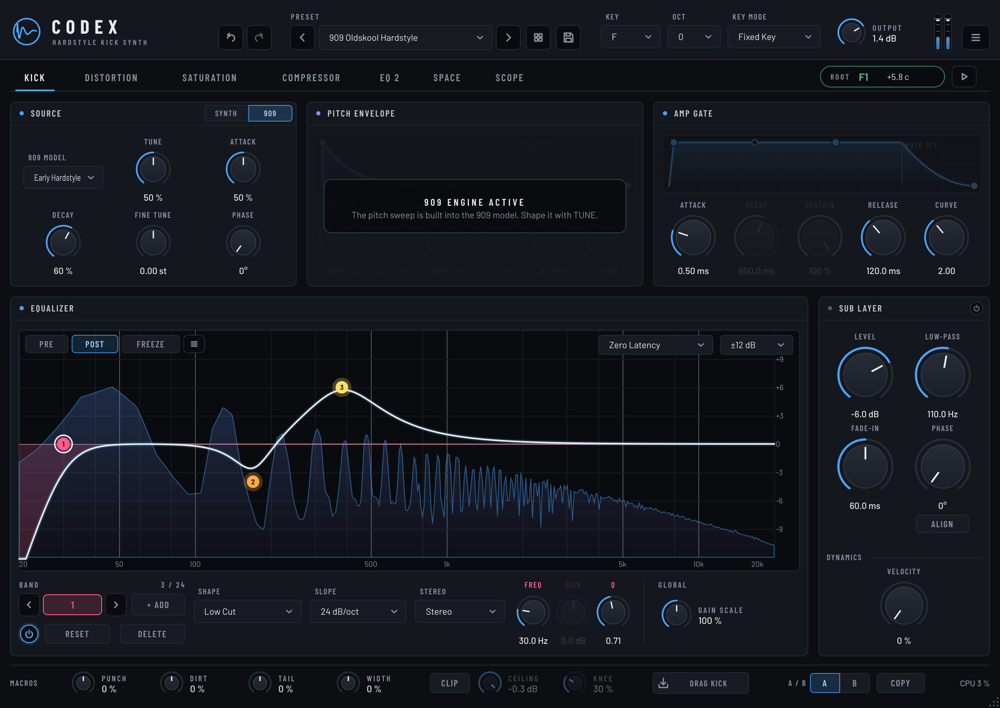
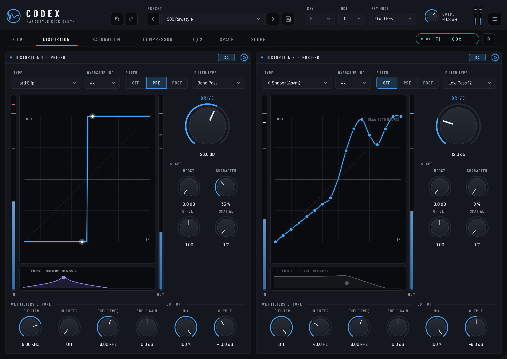
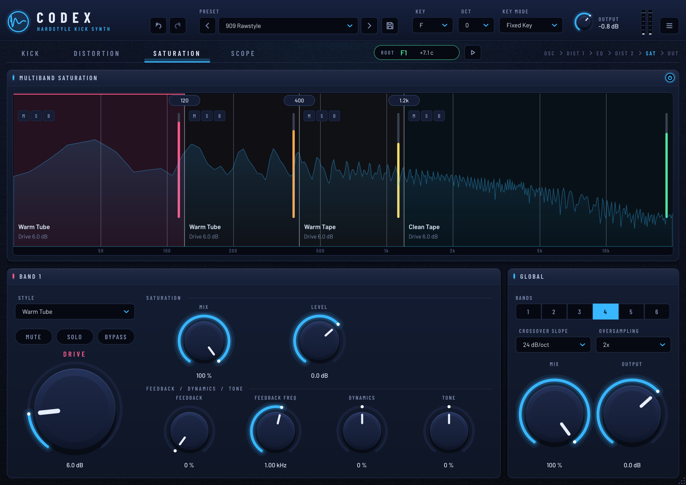
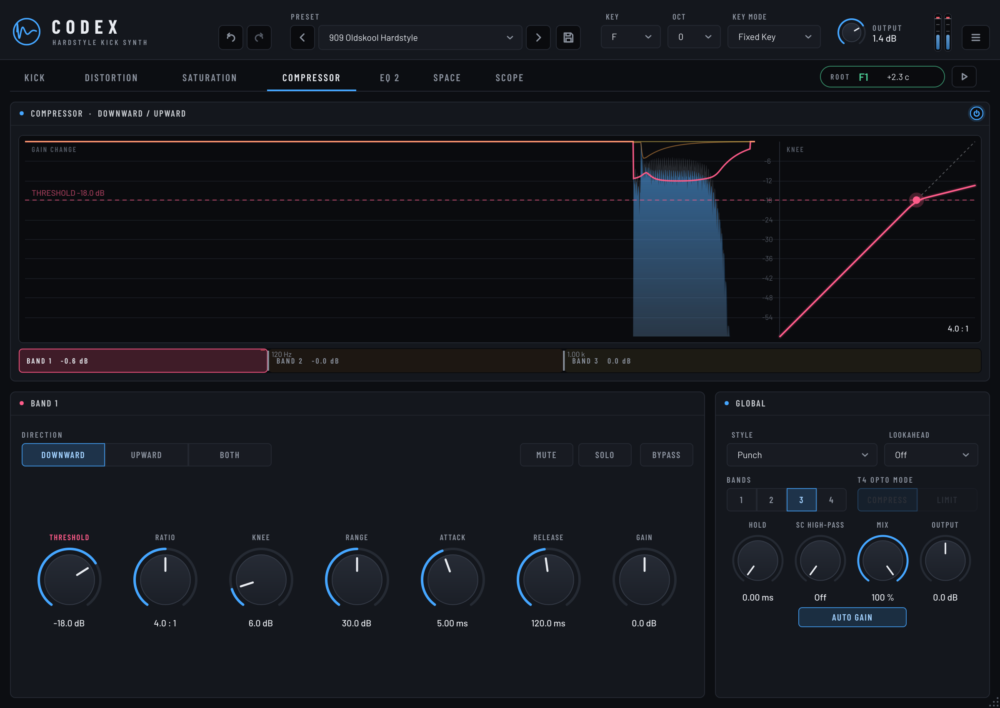
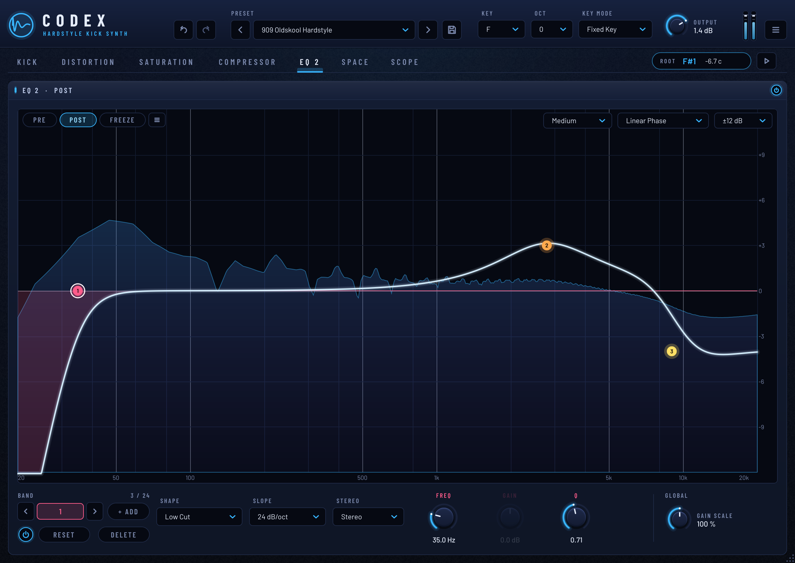
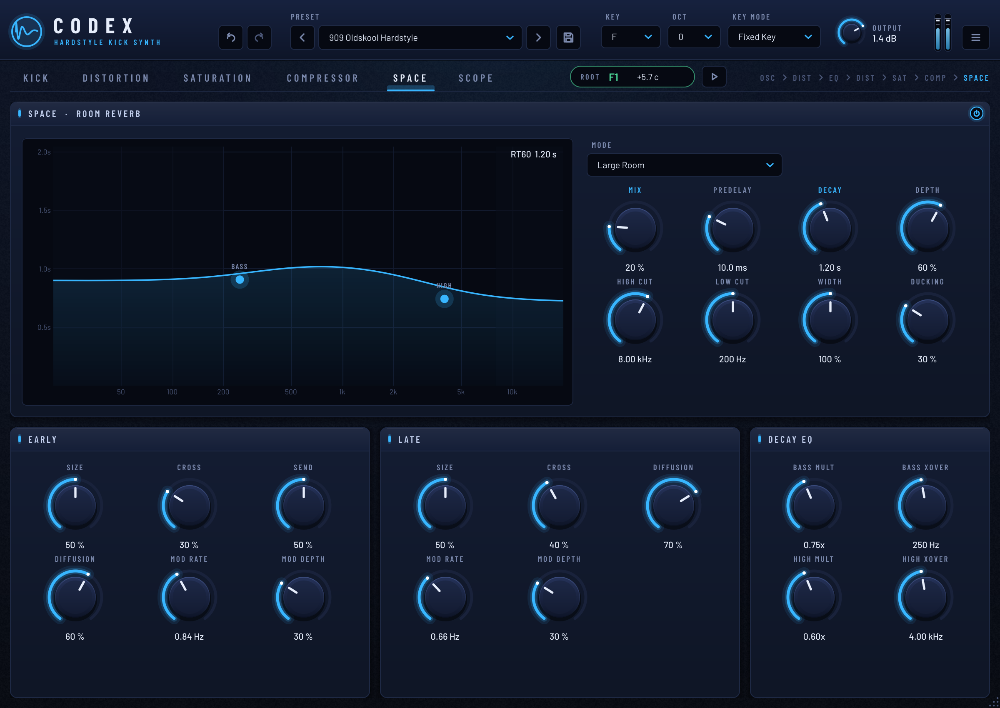
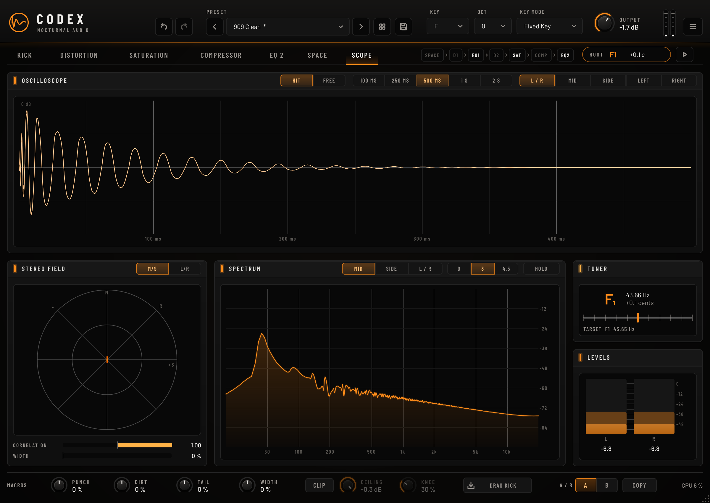

# Codex

**A free hardstyle kick synthesizer.** Codex builds kicks the way they were made before sample packs: a swept oscillator
(or a synthesized 909), distortion, EQ, distortion again, multiband saturation, a multiband compressor and a room reverb.
There are no samples; every kick is generated in real time, in the key of your track.

```
OSC / 909 -> DISTORTION 1 -> EQ 1 -> DISTORTION 2 -> SATURATION -> COMPRESSOR -> EQ 2 -> SPACE -> OUTPUT
```



| Distortion | Saturation | Compressor |
|---|---|---|
|  |  |  |

| EQ 2 | Space | Scope |
|---|---|---|
|  |  |  |

Formats: **VST3** (Windows, macOS, Linux), **AU** (macOS) and a **Standalone** app.

---

## Quick start
1. Load Codex on an instrument track and play any note (or hold the **play** button next to the root-note readout).
2. Set **KEY** to the key of your track. With *Fixed Key* mode, every MIDI note plays the kick in that key.
3. Browse the presets with the arrows next to the preset name.
4. Hover over any control to see what it does.

The **ROOT** readout in the tab bar is a tuner: it measures the actual root note coming out of the plugin, after all
distortion, so you can see your kick is in key. It turns green within 10 cents of the selected key.

## Your first hardstyle kick, step by step
1. Start from **Init** (or **909 Clean** for the 909 engine).
2. **Punch:** in *Pitch Envelope*, set *Amount* to 40–60 st and *Decay* to 60–150 ms. Lower *Curve* gives a longer "zap",
   higher gives a snappier hit.
3. **Length:** in *Amp Envelope*, set *Decay*/*Sustain* for the body; the note length controls the tail.
4. **First distortion:** *Dist 1* with *Overdrive* or *Hard Clip* and 18–30 dB of drive.
5. **EQ between the distortions:** this is the classic trick. Cut a narrow band around the low-mids (100–200 Hz) and boost
   around 300–500 Hz; whatever you boost here gets pushed hardest by the second distortion.
6. **Second distortion:** *Dist 2* with *Hard Clip* or *Diode* and a lower drive (6–14 dB). Use its *Hi Filter* (40–80 Hz)
   to keep the sub clean.
7. Optional: on the *Saturation* page, switch on multiband saturation to colour lows, mids and highs differently.
8. Optional width: turn up *Spatial* on a distortion unit, then add an EQ band with **Side** placement as a low cut
   (100–200 Hz) so the low end stays mono.
9. Check the ROOT readout and the output meter (keep the peak marker out of the red).

## Controls

### Top bar
| Control | What it does |
|---|---|
| Undo / Redo | Undo parameter changes and preset loads. |
| Preset | Factory presets first, then your own. Selecting the current preset again reverts your edits. |
| Save | Saves a user preset (`Documents/Codex/Presets/*.cdxpreset`). |
| Key / Oct | Root note, **F to E** (F1 = 43.65 Hz … E2 = 82.41 Hz), plus an octave shift. Presets never change the key. |
| Key Mode | *Fixed Key* plays the selected key from any MIDI note; *Follow MIDI* plays the note you press. |
| Output | Final output level, with a stereo meter. |
| Menu | Save/delete presets, open the preset folder, interface size (75–200 %), tooltips on/off, About. |
| ROOT / play | Tuner readout of the output's root note, and a play button that previews the kick in the selected key. |

### Kick page
| Section | Controls |
|---|---|
| **Source: Synth** | *Wave* (Sine, Triangle, Warm Sine), *Fine Tune*, *Phase* (start phase), *Click* (noise transient: level, decay, tone). |
| **Source: 909** | Synthesized 909-style bass drum. *909 Model* (Classic, Long Tail, Punch, Deep, Hard Attack, Gabber, Early Hardstyle, Boom, Driven, Short Tok) plus the original's *Tune* (sweep depth), *Attack* (click) and *Decay*. |
| **Pitch Envelope** | ADSR for the pitch sweep (drag the points in the display, or use the knobs), with *Amount* (semitones above the root) and *Curve*. Inactive in 909 mode. |
| **Amp Envelope** | ADSR for volume with *Curve*. In 909 mode it acts as a gate (attack and release only). |
| **Equalizer** | Up to **24 bands** (the Pro-Q 4 limit): double-click the display or press **+ ADD** to add one, **DELETE** (or the Delete key) to remove it, the power button or Alt-click to bypass it; only bands in use are shown. 10 shapes: Bell, Low/High Shelf, Low/High Cut, Notch, Band Pass, Tilt Shelf, Flat Tilt, All Pass. Slopes 6–96 dB/oct. Each band has a **stereo placement** (Stereo, Left, Right, **Mid**, **Side**); the display draws a result curve per channel group. Right-click a node to **split** a band into L+R or M+S. *Gain Scale* scales all gains at once. Analyzer with Pre/Post/Freeze and range/speed/tilt settings; display range 3/6/12/30 dB (expands automatically). |

**Processing mode** (both EQs, top right of the display, as in Pro-Q 4): *Zero Latency* (minimum phase, no delay),
*Natural Phase* (analog-matched response up to the top of the spectrum, a few samples of latency) or *Linear Phase*
(no phase shift, the waveform keeps its shape; latency depends on the *Resolution*: Low, Medium, High, Very High, Maximum).
The latency is reported to the host.

**EQ mouse controls:** drag a node for frequency/gain (Shift: fine, Ctrl/Cmd + vertical drag: Q) · mouse wheel: Q, or slope on
cut filters (Ctrl/Cmd + wheel: gain) · Alt-click or double-click a node: on/off · double-click empty space: new band (far left = low
cut, far right = high cut, bottom = notch, elsewhere = bell) · right-click a node: shape, slope, stereo placement, split, reset, delete · Delete / Backspace: delete the selected band ·
hover the display to read the frequency and note.

### Distortion page
Two full distortion units, one **before** and one **after** the EQ:

| Group | Controls |
|---|---|
| Type | 17 curves: Hard Clip, Soft Clip, Tanh, Overdrive, Tube, Diode, Diode 2, Fuzz, Sine Fold, Tri Fold, Rectify, Bitcrush, Asym Clip, Zero-Square, Downsample, X-Shaper, X-Shaper (Asym). The display shows the live transfer curve and the current input level. |
| Shape | *Drive*, *Boost* (input gain on dry and wet), *Character* (morphs any curve towards a square wave), *Offset* (asymmetry), *Spatial* (distorts left and right differently for stereo width). |
| Wet filters / tone | *Lo Filter* (low-pass before the distortion), *Hi Filter* (high-pass after it), *Shelf Freq/Gain*. |
| Output | *Mix* (dry/wet), *Output*. |
| Filter | Resonant *Pre* / *Post* filter on the distorted path (Low Pass 12/24, Band Pass, High Pass 12/24, Notch). Drag the response strip under the transfer display: left/right = frequency, up/down = resonance. A resonant band-pass *Pre* focuses the distortion on one part of the kick. |
| X-Shaper | In the *X-Shaper* modes, drag the points on the transfer display to draw your own curve (*Asym*: both halves separately); right-click for preset curves. |
| Options | *Oversampling* (Off/2x/4x/8x/16x) and *DC Filter*. Every curve also uses antiderivative anti-aliasing, so 4x already keeps audible aliasing around -64 dB on a hard-clipped 5 kHz tone. |

A bypassed unit is dimmed and shows an **ENABLE** card, so a switched-off stage cannot go unnoticed (the *909 Clean* preset
bypasses both units on purpose; every other preset switches them back on).

### Saturation page
Multiband saturation after Distortion 2, modelled on the feature set of classic multiband saturators:

| Group | Controls |
|---|---|
| Bands | 1–6 bands. Hover the top of the display and click **+** to split a band; the **×** in the band panel removes it. Drag crossover lines to move them, click a crossover handle for the slope (6/12/24/48 dB/oct, Linkwitz-Riley, phase-aligned so bands sum flat). Drag a band's **level handle** for level (Alt-drag: drive, Ctrl/Cmd-click: reset, wheel: level). M / S / B badges: mute, solo, bypass (Ctrl/Cmd-click: exclusive). |
| Per band | *Style* (20 styles: Tube, Tape, Transformer, Amp, Clip, FX), *Drive* (output level compensated automatically) with *Drive Pan*, *Mix*, *Level* with *Level Pan*, *Feedback* + *Feedback Freq* (dies away when the input stops), *Dynamics* (right: compression, left: gating), *Tone*: Bass, Mid, Treble, Presence. |
| Global | Power, *Channel Mode* (Stereo or Mid/Side), *Oversampling* (Off/2x/4x/8x), *Input*, *Mix*, *Output*. |

### EQ 2 page
A second, independent 24-band equaliser after the Compressor and before Space, for final shaping. Same shapes, stereo
placement, processing modes and mouse controls as EQ 1; the *Pre* analyzer shows the signal going into EQ 2. The power
button bypasses the whole EQ.

### Compressor page
Multiband compressor after the Saturation stage, modelled on the controls of FabFilter Pro-C 3 and the LA-3A:

| Group | Controls |
|---|---|
| Display | Scrolling input (grey) and output (blue) levels with each band's gain change. Drag the dashed **threshold** line; drag inside the **knee display** above the threshold to set the ratio. The band strip below shows live gain change per band; drag its dividers to move the crossovers (24 dB/oct Linkwitz-Riley, phase-aligned). |
| Per band | *Direction*: **Downward** (classic), **Upward** (brings quiet parts up, e.g. the tail) or **Both** (the threshold becomes a target level). *Threshold*, *Ratio* (1:1 to ∞), *Knee* (0–48 dB), *Range* (maximum gain change), *Attack*, *Release*, *Gain*; Mute / Solo / Bypass. |
| Global | *Style*: Clean, Punch, Smooth, Bus, Mastering, Classic, Vari-Mu, Opto, **T4 Opto (LA-3A)** (fixed ~10 ms attack, two-stage program-dependent release; *Compress / Limit* switch), Pumping, TTM (upward + downward). *Bands* (1–4), *Lookahead* (Off – 10 ms, reported as latency), *Hold*, *SC High-Pass*, *Mix* (parallel), *Output*, *Auto Gain*. |

### Space page
Stereo room reverb at the end of the chain, for width and ambience. The layout follows ValhallaRoom:

| Group | Controls |
|---|---|
| Main | *Mode* (Room, Large Room, Chamber, Hall, Plate, Warehouse), *Mix*, *Predelay*, *Decay* (RT60), *Depth* (early ↔ late), *High Cut*, *Low Cut* (keeps the sub out of the reverb), *Width*, *Ducking* (reverb dips while the kick hits). |
| Early | *Size*, *Cross*, *Send* (into the late reverb), *Diffusion*, *Mod Rate*, *Mod Depth*. |
| Late | *Size*, *Cross*, *Diffusion*, *Mod Rate*, *Mod Depth* (8-line modulated feedback delay network). |
| Decay EQ | *Bass Mult/Xover*, *High Mult/Xover*: decay of the lows and highs relative to *Decay*. The display shows the decay time across the spectrum; drag the BASS / HIGH handles. |

### Scope page
| Panel | What it shows |
|---|---|
| Oscilloscope | *HIT* captures every kick from the note-on; *FREE* runs continuously. Window 100 ms – 2 s. Channels: L/R overlaid, Mid, Side, Left or Right. |
| Stereo field | Vectorscope in *M/S* (mono = vertical line) or *L/R* orientation, with correlation and width meters. |
| Spectrum | Mid, Side or L/R; slope 0 / 3 / 4.5 dB per octave; peak hold. |
| Tuner, Levels | Full tuner; left/right peak and RMS meters with peak read-outs (click to reset). |

### Mouse and keyboard
Double-click any knob to reset it · Shift-drag for fine control · click a value to type it in · drag the bottom-right
corner to resize the window.

---

## Building from source
Requires CMake ≥ 3.22 and a C++17 compiler (Visual Studio 2022, Xcode 14+, or GCC/Clang). JUCE 8 is downloaded
automatically (or use `-DJUCE_DIR=/path/to/JUCE`).

```bash
cmake -S . -B build -DCMAKE_BUILD_TYPE=Release
cmake --build build --config Release
```

Plugins are written to `build/Codex_artefacts/Release/`. On Linux, install the JUCE dependencies first:
`libasound2-dev libfreetype-dev libx11-dev libxext-dev libxinerama-dev libxrandr-dev libxcursor-dev libfontconfig1-dev libgl1-mesa-dev`.

**Windows test builds from Linux** (cross-compiled with clang + MinGW-w64; official releases use Visual Studio):
```bash
cmake/mingw-compat/fetch-headers.sh build-win/mingw-overlay
cmake -S . -B build-win -G Ninja -DCMAKE_TOOLCHAIN_FILE=cmake/clang-mingw.cmake -DMINGW_OVERLAY_INCLUDE=$PWD/build-win/mingw-overlay -DCMAKE_BUILD_TYPE=Release
cmake --build build-win --target Codex_VST3
```
Copy `Contents/Resources/moduleinfo.json` from a native build into the Windows bundle (it cannot be generated when cross-compiling).

**Continuous integration:** `.github/workflows/build.yml` builds Windows, macOS (universal) and Linux, runs the offline
tests, validates the VST3 with [pluginval](https://github.com/Tracktion/pluginval) and uploads ready-to-use zips.

**Tests:** configure with `-DHK_BUILD_TOOLS=ON` and run `CodexRender out/`. It renders every factory preset,
checks the tuning of every key in both engines, every oversampling setting, several sample rates and block sizes, the mono
layout and state save/restore, and saves GUI screenshots.

## Project layout
```
Source/
  Parameters.*          all parameters (IDs, ranges, defaults)
  PresetManager.*       factory and user presets
  PluginProcessor.*     MIDI, the processing chain, scope capture
  DSP/                  KickVoice (synth + 909 engines), Kick909 models, CurveEnvelope,
                        ClipDistortion, ParametricEQ, MultibandSaturator, Compressor,
                        SpaceReverb, PitchDetector
  GUI/                  look-and-feel, widgets, EQ, distortion, saturation, compressor, space,
                        tuner, scope, overlays, editor
Resources/Fonts/        Barlow (SIL Open Font License)
docs/                   screenshots, research notes, release checklist
tools/Render.cpp        offline test tool
```

## Contributing
See [CONTRIBUTING.md](CONTRIBUTING.md). Repository rule: **files are never deleted**; deprecated files stay in place
with a note. Changes are listed in [CHANGELOG.md](CHANGELOG.md).

## Credits and licences
- Built with [JUCE](https://juce.com).
- Fonts: [Barlow](https://github.com/jpt/barlow) by The Barlow Project Authors, SIL Open Font License 1.1
  (`Resources/Fonts/OFL-Barlow.txt`, included with every build).
- VST is a registered trademark of Steinberg Media Technologies GmbH.
- Background research: [docs/RESEARCH.md](docs/RESEARCH.md).
